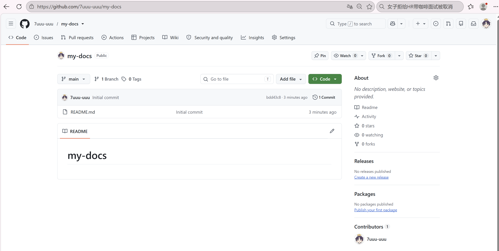
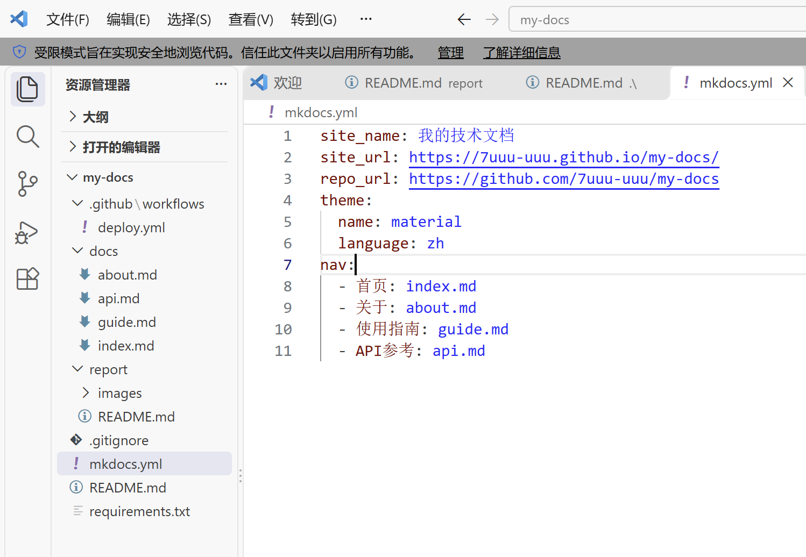
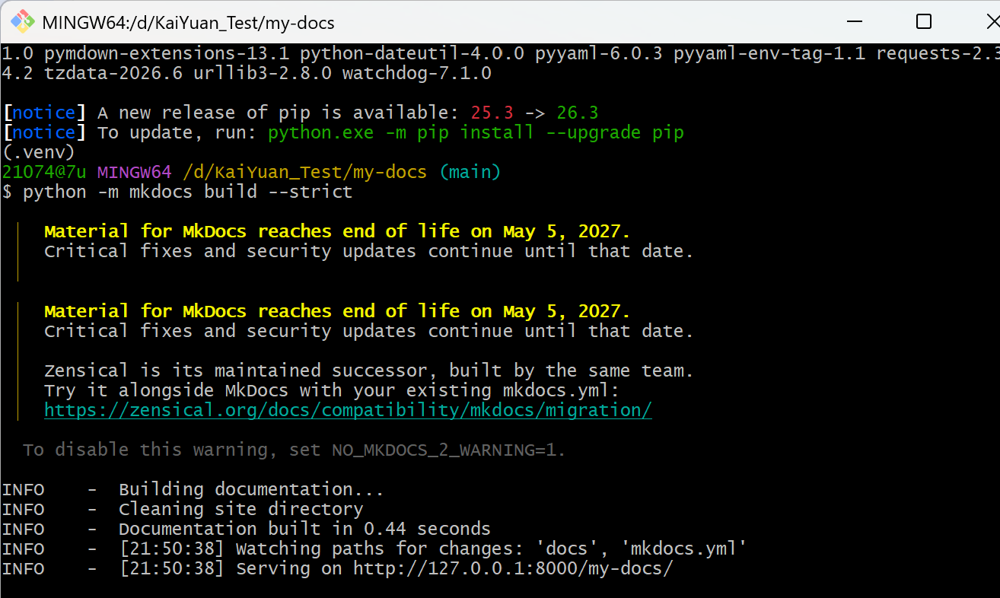
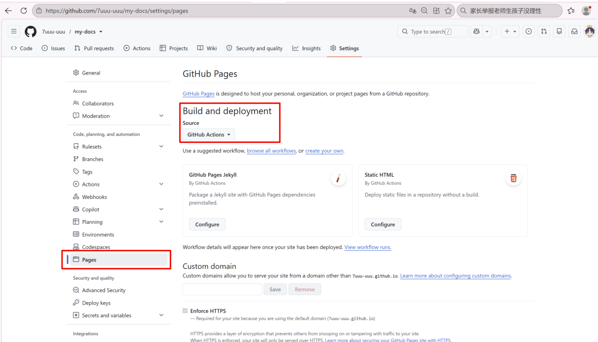
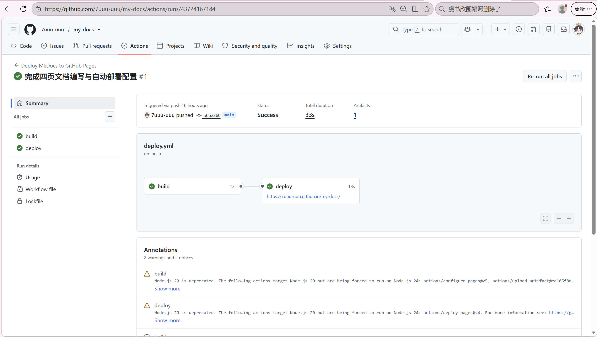
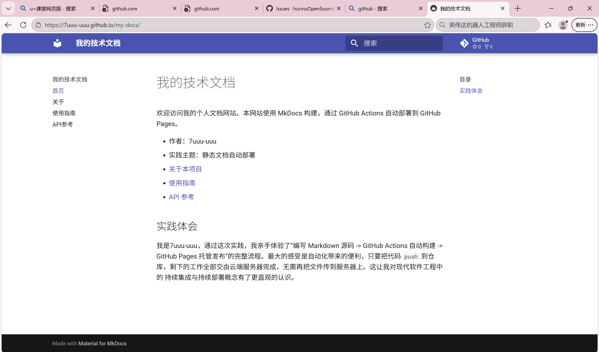
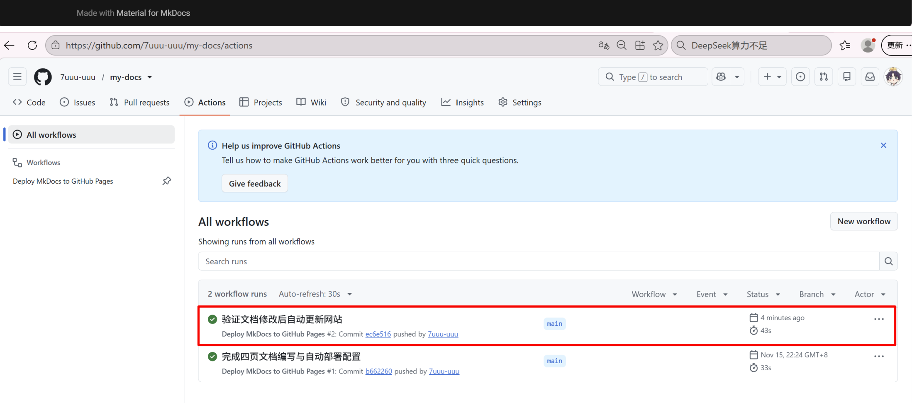
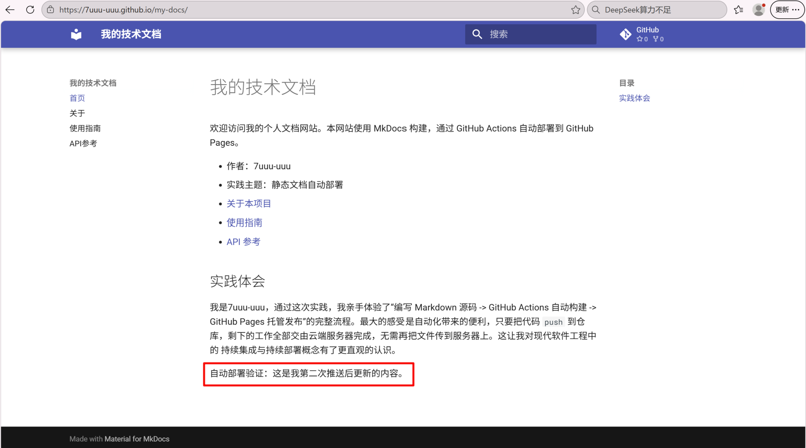

# 实践项目2：个人实验报告

## 1. 基本信息
- GitHub 登录名：7uuu-uuu
- 个人仓库地址：https://github.com/7uuu-uuu/my-docs
- 最终网站地址：https://7uuu-uuu.github.io/my-docs/

## 2. 实践过程与关键截图

### 2.1 仓库创建
我使用本人的 GitHub 账号创建了一个名为 `my-docs` 的公开仓库，确认默认分支为 `main`，并在本地克隆了该仓库。

### 2.2 项目结构与 MkDocs 配置
在 VS Code 中，我按标准结构建立了文件目录，配置了 `mkdocs.yml`。

**结构说明**：
- **`docs/`**：存放我手写的 Markdown 源文件。它是网站的“原材料”。
- **`nav`**（在 `mkdocs.yml` 中）：定义了网站顶部导航栏的菜单名称和对应的文件路径，控制网页的结构。
- **`site/`**：是 MkDocs 根据 `docs/` 自动生成的静态网页产物（HTML/CSS）。因为每次推送代码都会在云端自动重新生成它，所以本地不需要手工修改，也不需要把它提交到 GitHub（已被 `.gitignore` 忽略）。

### 2.3 本地构建或预览
在本地终端中，我创建并激活了 Python 虚拟环境，安装了所需依赖，并成功运行了 `python -m mkdocs serve` 进行预览。

**检查内容说明**：我在浏览器打开了 `http://127.0.0.1:8000/`，依次点击了四个页面，确认了导航栏切换正常；表格排版无误，JSON代码块显示正常；并测试了页面内部的超链接（如“返回首页”）均可正常跳转。

### 2.4 Pages 设置
进入仓库的 `Settings` -> `Pages`，我将 `Build and deployment` 的 `Source` 选项设置为了 **GitHub Actions**，摒弃了旧版的分支发布模式，为官方推荐的工作流部署做好准备。

### 2.5 Actions 首次构建和部署
向 `main` 分支推送代码后，配置的 GitHub Actions 工作流被成功触发。在 Actions 页面可以看到 `build`（构建）和 `deploy`（部署）两个任务均顺利变绿，说明云端自动构建与发布成功。

### 2.6 网站访问与四页导航检查
通过 GitHub Pages 提供的网址，我成功访问了部署好的公开网站。我逐一检查了首页、关于、使用指南、API参考四个页面，确认内容均已生效。

### 2.7 第二次推送与自动更新验证
为了验证自动更新功能，我在 `docs/index.md` 中增加了一句话。保存并第二次 `git push` 后，Actions 自动触发了新的运行记录并成功完成部署。刷新网站后，新增的文字立刻生效，证明自动化流水线完全畅通。
- 对应提交链接：https://github.com/7uuu-uuu/my-docs/commit/ec6e516835168ee506555fe7d06aaabaff9e00dd
- 对应 Actions 运行链接：https://github.com/7uuu-uuu/my-docs/actions/runs/43822238121

## 3. 问题与解决
在实践过程中，我遇到了几个典型问题并成功解决：
1. **Git 推送报错 `Password authentication is not supported`**：
   - **原因**：GitHub 已不再支持使用账号密码直接进行 HTTPS 认证。
   - **解决**：我清理了 Windows 凭据管理器里旧的 GitHub 凭据，并在终端重新 `push` 时选择了通过浏览器授权登录（或生成 Personal Access Token），最终成功推送。
2. **终端执行 `git diff --staged` 时卡住不动**：
   - **原因**：Git 默认调用的分页器进入了阅读模式，等待用户操作。
   - **解决**：按下键盘上的 `q` 键即可退出阅读模式，回到正常的命令行终端。
3. **首次自动化构建核对**：我在 Actions 页面核对了工作流文件配置，确认了 `paths` 包含 `docs/**` 和 `mkdocs.yml`，并核对了 `deploy` 任务的权限（`pages: write` 等）配置均无误。

## 4. 原理理解
1. **`docs/` 和 `site/` 各保存什么？为什么不用手工修改 `site/`？**

   `docs/` 存放编写的 Markdown 文档源码；`site/` 是 MkDocs 基于源码自动编译生成的静态网站资源（html、css、js）。`site/` 是构建产物，每次执行 `mkdocs build` 都会全部重新生成，手动修改里面的内容会在下一次构建时被覆盖，因此不需要手动修改，也一般不提交到版本库。

2. **本次工作流在什么情况下自动运行？**

   向 `main` 分支执行 push，并改动文件命中 `docs/**`、`mkdocs.yml`、`requirements.txt`、工作流 yaml 文件时才会运行；另外也可以在 Actions 页面手动点击 `Run workflow` 手动触发。

3. **`build` 与 `deploy` 两个任务有什么区别？**

   `build`：拉取仓库代码、搭建 Python 环境、安装依赖、执行 `mkdocs build` 生成静态站点，并把站点打包为 pages 制品上传；

   `deploy`：依赖 build 任务成功完成之后才执行，接收 build 上传的站点制品，部署发布到 GitHub Pages 服务。两个任务解耦，构建失败就不会执行发布。

4. **只修改 `report/README.md` 会触发部署吗？为什么？**

   不会触发部署。因为工作流文件 `deploy.yml` 的 `paths` 过滤规则只监听 `docs/**`、mkdocs 配置等相关文件路径，`report/` 目录不在监听范围内，修改该目录文件不会触发 workflow。

5. **本次方案为何无需创建 `gh-pages` 分支？**

   旧方案需要把静态文件提交推送到 `gh-pages` 分支，GitHub Pages 从该分支读取网页。新版 `deploy-pages` 采用 artifact 工件机制：构建后上传静态文件作为工件，部署步骤直接读取工件发布，不需要单独维护 `gh-pages` 分支。